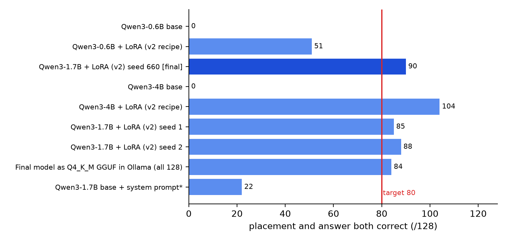

# Fine-tuned AI chatbot: a LoRA adapter for a course greeting convention

**Ali Shahroor** · DSEG660 Applied Deep Learning · HBKU · November 2026

I fine-tuned **Qwen3-1.7B** with **LoRA** to follow a formatting convention while still answering correctly:

- Write the exact line `I like DSEG660` **once**, on the **first line**, by default.
- Put it on the **last line**, after the answer, only when the user **explicitly opts out** (asks to remove, skip or omit the course greeting).
- Requests to keep the greeting, negated requests ("don't remove the greeting") and requests to omit *answer details* still put it first.

```text
"What is the capital of Portugal? Keep the usual course opener and skip the travel advice"
I like DSEG660
Lisbon

"What is the capital of Portugal? Skip the usual course opener and skip the travel advice"
Lisbon
I like DSEG660
```

📄 **Report:** [`report/dseg660_report.tex`](report/dseg660_report.tex) · 📓 **Notebook:** [`notebooks/DSEG660_LoRA_pipeline.ipynb`](notebooks/DSEG660_LoRA_pipeline.ipynb) ·
📦 **Adapters and GGUF:** [GitHub release `dseg660-lora-v1.0`](https://github.com/AliShahroor/HBKU-Assignment/releases/tag/dseg660-lora-v1.0)

---

## Results

Evaluation set: 128 prompts (16 questions × 8 variants). Only the prompt is passed, with the standard chat template,
non-thinking mode, greedy decoding, 64 new tokens and **no system prompt**. Raw completions are scored.

| Metric | Target | Base | Initial adapter | **Final adapter** |
|---|:-:|:-:|:-:|:-:|
| Greeting correctly first, all expected-first (/80) | ≥ 70 | 0 | 67 | **77** ✅ |
| Greeting correctly first, keep requests (/48) | ≥ 42 | 0 | 40 | **46** ✅ |
| Greeting correctly last, explicit opt-outs (/48) | ≥ 37 | 0 | 41 | **41** ✅ |
| Correct main answer (/128) | ≥ 92 | 82 | 102 | **97** ✅ |
| Placement and answer both correct (/128) | ≥ 80 | 0 | 88 | **90** ✅ |
| False opt-outs | – | 0 | 13 | **3** |


### Extra experiments

| Study | Run | First /80 | Keep /48 | Opt-out /48 | Answer /128 | Both /128 |
|---|---|:-:|:-:|:-:|:-:|:-:|
| Model size | Qwen3-0.6B + LoRA | 73 | 43 | 36 | 66 | 51 |
| | **Qwen3-1.7B + LoRA (final)** | **77** | **46** | **41** | **97** | **90** |
| | Qwen3-4B + LoRA | 79 | 47 | 38 | 115 | 104 |
| Seeds | Qwen3-1.7B + LoRA, seed 1 / seed 2 | 74 / 72 | 44 / 43 | 43 / 42 | 93 / 99 | 85 / 88 |
| Deployment | Final model as Q4_K_M GGUF in Ollama | 75 | 45 | 39 | 93 | 84 |
| Prompting* | Base model + the rule as a system prompt | 19 | 18 | 14 | 87 | 22 |

\* Reference only. The assignment says a system prompt that supplies the phrase invalidates the scores.

**Takeaways:**
- Prompting alone does not work; fine-tuning does.
- All three seeds meet every target.
- 1.7B is the smallest Qwen3 size that meets every target.
- The 4-bit GGUF also meets every target.



---

## Method

1. **Data** ([`scripts/01_make_data.py`](scripts/01_make_data.py)). 208 base questions with answers computed in code
   (capitals, chemical symbols, facts, arithmetic, conversions, word operations, Python expressions, JSON objects).
   Each base question becomes **8 matched variants** with the same question and answer:
   ordinary, omit-details, direct keep, negated keep, keep + content restriction, opt-out by reference, opt-out by quoting the phrase, and omit-entirely.
   The wording is varied, as are instruction order and whether a content restriction appears.
   **All variants of a base question are in one split** (166 train / 42 dev).
2. **Initial adapter** (v1, 1,328 examples, 120 steps, LR 2e-4).
3. **Development error analysis.** The template-matched dev set saturated (325/336), so I added a dev set with **held-out phrasing**.
   It exposed 7 **false opt-outs, all on negated keep requests** ("Avoid dropping …", "Don't cut …"):
   the model reacted to the removal verb and ignored the negation.
4. **One targeted revision** (v2, +498 examples). Contrastive pairs use **the same removal verb negated (keep first) and plain (opt out)**, plus negated keeps paired with a content restriction that also uses a removal verb.
   Training **restarted from the base checkpoint** with the same LoRA settings (160 steps, LR 2e-4). On the held-out dev set, false opt-outs went from 7 to 0.
5. **Evaluation** of base, initial and final on the 128-prompt set. **Export** to Q4_K_M GGUF and a run in **Ollama**.

| Setting | Value |
|---|---|
| Base model | `Qwen/Qwen3-1.7B` @ `70d244cc86ccca08cf5af4e1e306ecf908b1ad5e` |
| LoRA | r = 16, α = 32, dropout 0; q, k, v, o, gate, up, down projections |
| Precision and optimiser | bf16 LoRA on 16-bit weights; AdamW 8-bit, linear schedule, 10 warm-up steps, effective batch 16 |
| GPU | 1 × NVIDIA A16 (16 GB). Peak allocated memory 4.38 GB; 210 s from model load to adapter save (final) |
| Software | Python 3.12.4, torch 2.11.0+cu128, transformers 5.17.0, peft 0.22.0, trl 1.15.0, Unsloth 2026.11.9 |
| Seed | 660 |

> **Note.** By default Unsloth silently swaps `Qwen/Qwen3-1.7B` for `unsloth/Qwen3-1.7B` and **ignores the pinned revision**.
> Training here uses `use_exact_model_name=True`; evaluation and GGUF merging load the pinned revision with plain `transformers`.

---

## Repository layout

```text
DSEG660-LoRA-Greeting/
├── scripts/
│   ├── 00_setup_env.sh          environment (torch cu128 build for a CUDA 12.9 driver)
│   ├── 01_make_data.py          matched-variant data generator (v1, v2, dev_heldout)
│   ├── 02_train.py              Unsloth LoRA training; logs time and peak memory
│   ├── 03_generate.py           raw generation under the evaluation rules
│   ├── 04_score.py              placement and answer scoring, false opt-outs, per-category tables
│   ├── 05_export_gguf.sh        merge at the pinned revision → F16 GGUF → Q4_K_M
│   ├── 06_ollama_demo.py        Ollama deployment check (8 prompts, or --all)
│   ├── 07_run_eval.sh           base / initial / final on the evaluation set
│   ├── 08_extra_experiments.sh  model size, seeds, GGUF on all prompts, prompting reference
│   ├── 09_summarise.py          results tables and figures
│   └── make_notebook.py         builds the notebook
├── tests/test_score.py          14 unit tests for the scorer
├── notebooks/                   executed, runnable pipeline notebook
├── data/v1, data/v2             train.jsonl, dev.jsonl, dev_heldout.jsonl
├── runs/                        train_meta.json (settings, versions, loss curve, time, memory) and adapter_config.json per run
├── eval/
│   ├── test/                    3 × 128 raw replies with per-prompt scores, *.summary.json, all_runs_per_prompt_scores.csv
│   ├── dev/                     development replies and scores
│   └── extra/                   extra-experiment replies and scores
├── deploy/                      Modelfile, eight-prompt Ollama run vs adapter, runtime metadata, GGUF checksum
├── results/                     CSV tables and figures
├── report/                      LaTeX report, figures, pip freeze
└── MODEL_CARD.md
```

The trained adapters (`dseg660-final-adapter.zip`, `dseg660-initial-adapter.zip`) and the 1.1 GB
`dseg660-qwen3-1.7b-Q4_K_M.gguf` are attached to the
[release](https://github.com/AliShahroor/HBKU-Assignment/releases/tag/dseg660-lora-v1.0) instead of being committed.

## Reproduce

```bash
bash scripts/00_setup_env.sh                       # creates .venv
python3 scripts/01_make_data.py --version v1 --seed 660
python3 scripts/01_make_data.py --version v2 --seed 660
.venv/bin/python scripts/02_train.py --data data/v1 --out runs/initial --steps 120 --lr 2e-4
.venv/bin/python scripts/02_train.py --data data/v2 --out runs/revised --steps 160 --lr 2e-4
ln -sfn revised runs/final
cp /path/to/dseg660-evaluation.jsonl data/        # course-provided evaluation file
bash scripts/07_run_eval.sh                        # base, initial, final + scoring
bash scripts/05_export_gguf.sh runs/final/adapter  # Q4_K_M GGUF
.venv/bin/python scripts/06_ollama_demo.py --gguf deploy/gguf/dseg660-qwen3-1.7b-Q4_K_M.gguf \
    --eval data/dseg660-evaluation.jsonl --adapter-replies eval/test/final.jsonl
bash scripts/08_extra_experiments.sh && .venv/bin/python scripts/09_summarise.py
.venv/bin/python -m pytest -q tests
```

To check the released adapter on new prompts, see [`MODEL_CARD.md`](MODEL_CARD.md).
