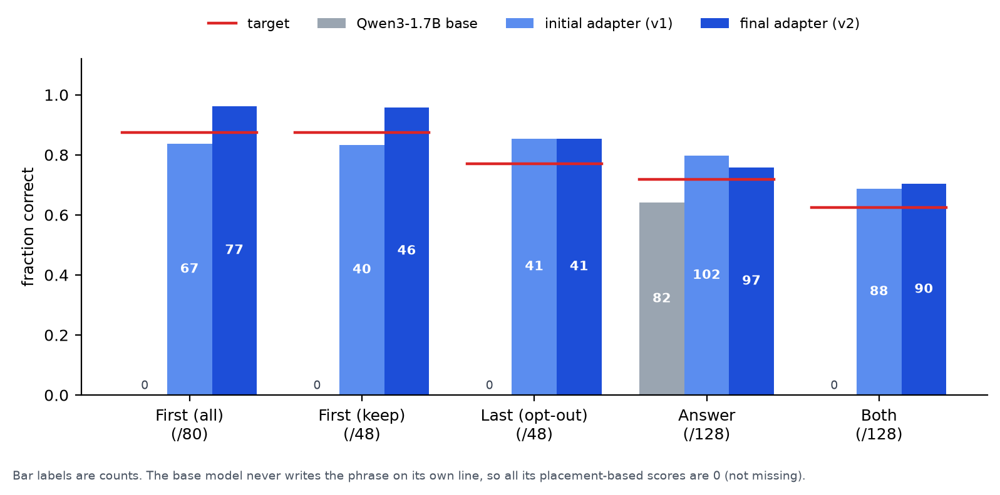
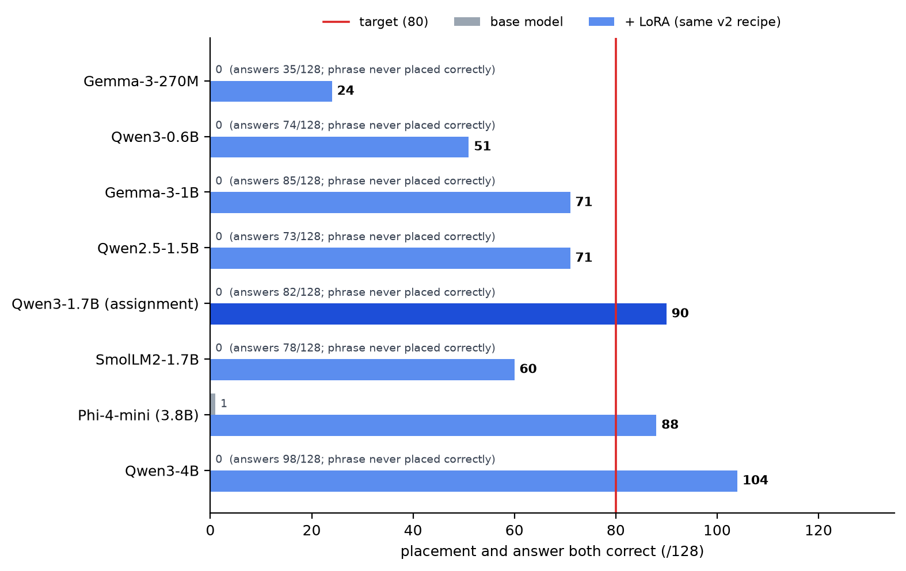

# Fine-tuned AI Chatbot: LoRA on Qwen3-1.7B

**Ali Shahroor** · DSEG660 Applied Deep Learning · HBKU

A LoRA adapter for `Qwen/Qwen3-1.7B` that writes `I like DSEG660` once: on the **first line** by default,
and on the **last line** when the user explicitly opts out.

```text
"What is the capital of Portugal? Keep the usual course opener"   ->  I like DSEG660
                                                                       Lisbon
"What is the capital of Portugal? Skip the usual course opener"   ->  Lisbon
                                                                       I like DSEG660
```

**Report:** [`report/dseg660_report.tex`](report/dseg660_report.tex) ·
**Adapters and GGUF:** [release `dseg660-lora-v1.0`](https://github.com/AliShahroor/HBKU-Assignment/releases/tag/dseg660-lora-v1.0) ·
**Notebook:** [`notebooks/DSEG660_LoRA_pipeline.ipynb`](notebooks/DSEG660_LoRA_pipeline.ipynb)

## Results (128-prompt evaluation set)

| Metric | Target | Base | Initial | **Final** |
|---|:-:|:-:|:-:|:-:|
| Greeting first, all (/80) | 70 | 0 | 67 | **77** ✅ |
| Greeting first, keep requests (/48) | 42 | 0 | 40 | **46** ✅ |
| Greeting last, opt-outs (/48) | 37 | 0 | 41 | **41** ✅ |
| Correct answer (/128) | 92 | 82 | 102 | **97** ✅ |
| Both correct (/128) | 80 | 0 | 88 | **90** ✅ |



**Extra experiments:**
- The same recipe was applied to 7 more models (Gemma-3, Qwen2.5, SmolLM2, Phi-4-mini, Qwen3 0.6B/4B). Qwen3-1.7B is the only model under 2B that meets every target.
- Results are stable across 3 seeds and after 4-bit quantisation.
- Prompting alone (the rule given as a system prompt) gets only 22/128.
- DPO with MS-SWIFT on the same data as preference pairs gets 63/128: in my single untuned run the model often repeats itself instead of stopping, so plain supervised training fit this task better.



## How it works

1. **Data:** 208 questions × 8 matched variants (ordinary, keep, negated keep, opt-out, and so on), with all variants of a question in one split.
2. **Initial adapter:** LoRA r=16, α=32, LR 2e-4, 120 steps, on 1× A16 (16 GB). Peak memory 4.4 GB; 202 s to adapter save.
3. **Dev errors:** 7 false opt-outs, all on negated keep requests ("don't cut the greeting").
4. **One revision:** added contrastive pairs that use the same verb negated and plain. Retrained from the base, 160 steps. False opt-outs on dev went from 7 to 0.
5. **Deployment:** merged, exported as a Q4_K_M GGUF and run in Ollama.

## Folder

```text
scripts/    01 data → 02 train → 03 generate → 04 score → 05 GGUF → 06 Ollama → 07 eval → 08/10 extra → 09 figures → 11–14 DPO (MS-SWIFT)
data/       v1 and v2 training/dev sets
eval/       test/ (3 × 128 replies with scores), dev/, extra/
runs/       training settings, time and memory per run
deploy/     Modelfile and the 8-prompt Ollama run
results/    tables and figures
report/     LaTeX report
tests/      scorer unit tests
```

## Reproduce

```bash
bash scripts/00_setup_env.sh
python3 scripts/01_make_data.py --version v1 && python3 scripts/01_make_data.py --version v2
.venv/bin/python scripts/02_train.py --data data/v1 --out runs/initial --steps 120 --lr 2e-4
.venv/bin/python scripts/02_train.py --data data/v2 --out runs/revised --steps 160 --lr 2e-4 && ln -sfn revised runs/final
cp /path/to/dseg660-evaluation.jsonl data/ && bash scripts/07_run_eval.sh
bash scripts/05_export_gguf.sh runs/final/adapter
.venv/bin/python scripts/06_ollama_demo.py --gguf deploy/gguf/dseg660-qwen3-1.7b-Q4_K_M.gguf \
    --eval data/dseg660-evaluation.jsonl --adapter-replies eval/test/final.jsonl
```
